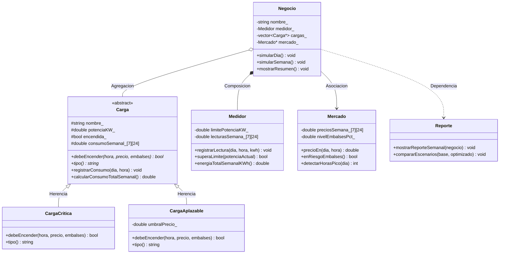

# WattControl - Sistema de Gestion Energetica (Panaderia) - Evidencia 3

Sistema en C++ orientado a objetos para simular, controlar y optimizar el consumo electrico semanal (7 dias x 24 horas) de una panaderia comercial en Colombia, respetando el limite de potencia contratada (9.0 kW), franjas horarias pico (18:00-20:00) y alertas por nivel critico de embalses (< 40%).

---

## Arquitectura Orientada a Objetos (POO)

* **Herencia (`Carga` -> `CargaCritica`, `CargaAplazable`):** Polimorfismo en la decision de encendido (`debeEncender`) segun la criticidad operativa del equipo y el estado del mercado.
* **Composicion (`Negocio` *-- `Medidor`):** El medidor inteligente pertenece exclusivamente al negocio y almacena la matriz semanal de consumo (`[7][24]`).
* **Agregacion (`Negocio` o-- `Carga*`):** El negocio administra una coleccion dinamica de equipos electricos independientes.
* **Asociacion (`Negocio` --> `Mercado*`):** El negocio consulta las tarifas horarias en COP/kWh y el porcentaje de embalses.
* **Dependencia (`wattcontrol.cpp`, `Reporte`, `utilidades`, `configuracion`):** Modulos transversales de analisis semanal, proyeccion mensual (x 4) y reportes en consola.

---

## Diagrama de Clases (UML)



---

## Estructura del Proyecto

```text
wattcontrol-Evidencia3/
├── include/
│   ├── Carga.h
│   ├── CargaAplazable.h
│   ├── CargaCritica.h
│   ├── Medidor.h
│   ├── Mercado.h
│   ├── Negocio.h
│   ├── Reporte.h
│   ├── configuracion.h
│   └── utilidades.h
├── src/
│   ├── Carga.cpp
│   ├── CargaAplazable.cpp
│   ├── CargaCritica.cpp
│   ├── Medidor.cpp
│   ├── Mercado.cpp
│   ├── Negocio.cpp
│   ├── Reporte.cpp
│   └── wattcontrol.cpp
└── README.md
```

---

## Compilacion y Ejecucion

```bash
g++ -std=c++17 -Wall -Wextra -Iinclude src/*.cpp -o wattcontrol
./wattcontrol
```

---

## Equipo de Desarrollo y Modulos (Evidencia 3)

| Integrante | Issue | Modulo / Responsabilidad |
| :--- | :---: | :--- |
| **Stify** (Lider) | `#1` | Configuracion semanal (`[7][24]`), utilidades transversales, integracion y documentacion (`README.md`) |
| **Gissell** | `#2` | Modelado semanal del `Mercado` energetico, sobrecostos horarios y alertas de embalses (`< 40%`) |
| **Daniela** | `#3` | Jerarquia de `Carga` (`CargaCritica`, `CargaAplazable`) y reportes comparativos de ahorro (`Reporte`) |
| **Isaac** | `#4` | Orquestacion de `Negocio`, registro en `Medidor` semanal y menu principal (`src/wattcontrol.cpp`) |
